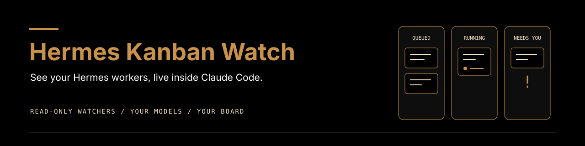

<p align="center">
  
</p>

# Hermes Kanban Watch

<p align="center">
  <a href="LICENSE"></a>
  <a href="https://code.claude.com/docs/en/plugins"></a>
  <a href="https://github.com/NousResearch/hermes-agent"></a>
  <a href="https://atlas-ai.au"></a>
</p>

**One cheap native watcher per Kanban board, reporting to the session that started it.**

The default is one background agent, not a Workflow: Claude Code uses Sonnet,
Codex uses its own Luna subagent, and Hermes uses the dedicated Gemini watcher
profile with a cheap GLM fallback. Summaries arrive every 15 minutes, new problems are reported promptly,
and one final note ends the watcher. For an operator working in Discord, the
helper posts directly; otherwise the starting session relays updates to the
operator. The old live-row Workflow remains explicit opt-in only.
This is a reader, not a dispatcher or a second owner of the work.

## What you get

| Feature | What it does |
| --- | --- |
| One watcher | One cheap native agent per board, with a shared local singleton lease. |
| 15-minute summaries | Done, running, waiting, problems and honest rough time left. |
| Immediate problems | Blocked, ready without a worker, spawn guards/failures, parent questions and overruns. |
| Final note | Stops only on done/archived, the watch deadline or an explicit UNKNOWN error. |
| Honest reads | Failed or denied reads are UNKNOWN, never quietly turned into DONE. |
| Setup checks | A credential-safe doctor, opt-in local setup and optional model probes. |
| Portable routes | Your profiles, your models, with a different-family reviewer. |

See the plugin's [Features list](plugin/README.md#features) for the round-2 commands and workflow details.

## Quick install

In Claude Code 2.1.275 or later, install in one step:

```text
/plugin install hermes-kanban-watch --marketplace Atlas-X-AI/hermes-kanban-watch
```

Alternatively, add the marketplace and install with these two commands:

```text
/plugin marketplace add Atlas-X-AI/hermes-kanban-watch
/plugin install hermes-kanban-watch@hermes-kanban-watch
```

You need Python 3.11+, Hermes Agent on PATH, existing Hermes profiles, and Claude
Code with plugin and background Agent support. The default watch does not need
Workflow support. The Linux session-inbox bridge additionally needs tmux and
an existing inbox poller; systemd is needed only for the explicit Hermes bridge.

Replace `<plugin dir>` below with the installed plugin directory containing
`scripts/doctor.py` (not the marketplace root). Run in your terminal:

```sh
python3 "<plugin dir>/scripts/doctor.py"
python3 "<plugin dir>/scripts/doctor.py" --fix
export PATH="$HOME/.local/bin:$PATH"
python3 "<plugin dir>/scripts/doctor.py"
```

The first command only checks setup. `--fix` opts into three local setup actions:
initialise a missing default board with `hermes kanban --board default init`
or a missing named board with `hermes kanban boards create <slug>`, copy the routes template to
`~/.config/hermes-kanban-watch/routes.yaml`, and create a `~/.local/bin/hermes-kanban-live`
shim. It never overwrites existing files, including symlinks, creates profiles,
or changes credentials. Edit the copied routes to name your existing profiles.
Keep the plugin installed: the shim points to that location. After moving or
reinstalling the plugin, inspect and update that shim yourself; `--fix` leaves it alone.

Doctor reports PASS / FAIL / UNKNOWN. Exit 0 means no FAILs, not that UNKNOWNs
were verified. It checks Hermes's version, board-file existence (not schema
compatibility), `model.provider` and `model.default` in profile configs, routed
profile existence and the reader on PATH. The reader's `--version` must print
exactly `hermes-kanban-watch 0.4.2`. A foreign or stale `hermes-kanban-live` is FAIL,
with its resolved path shown, even with `--fix`. Move that command aside or fix
PATH before rerunning `--fix`, or use `args.live_cmd` for this plugin's reader.
The doctor never overwrites a conflicting command. Existing unrelated
`kanban-live` commands are not used or changed. Unsupported config shapes are UNKNOWN.
It never opens `.env`, `auth.json`, session stores or other credential files.

### Read-only permissions

Doctor prints these exact permission entries. Add them using Claude Code's
permission UI/settings if needed, not a blanket approval for Bash:

```text
Bash(hermes-kanban-live cards:*)
Bash(hermes-kanban-live snapshot:*)
Bash(hermes-kanban-live wait-start:*)
Bash(hermes-kanban-live wait-any:*)
Bash(hermes-kanban-live follow:*)
Bash(hermes-kanban-live events:*)
Bash(hermes-kanban-live active:*)
Bash(hermes-kanban-live scout:*)
Bash(hermes-kanban-live needs:*)
```

A `live_cmd` override needs matching permissions. The watcher never retries a
permission denial or broadens its own permissions.

For a source checkout instead of marketplace installation:

```sh
claude --plugin-dir /path/to/hermes-kanban-watch/plugin
```

## How it works

```text
Hermes Kanban board (SQLite mode=ro)
                  |
                  v
     board_watch.py wait + summary
                  |
                  v
       ONE native cheap watcher
                  |
                  v
     Starting session -> operator
```

For Claude Code, prepare a lease/brief with
`bash "<plugin dir>/scripts/start_watcher.sh" --prepare-only --board demo --session exact-tmux-name`,
then launch ONE background `hermes-kanban-watch:kanban-watcher` Agent on Sonnet.
When working in Discord, `--prepare-only --discord-channel <channel-id>` enables
conditional direct reports: the sender must verify identity in the helper's actual
execution context, not merely resolve the parent pane. Detached direct-Discord
launches are refused before taking a lease or creating a service; omit
`--discord-channel` and use parent relay instead. On a supported direct route the
starting session does not relay reports and receives only problems and FINAL/stop
notes. A delivery UNKNOWN retains pending state and safe failure kind/exit status,
then refuses further send attempts until reconciliation. No retry override is provided.
Without the option, it queues every report as a `project_channel_message` for
the exact session/pane; the existing inbox poller types it at an idle prompt.
Queued is not delivered. Claude Code runs each helper with Bash
`run_in_background: true`, waits for completion notification, then reads only the
last output lines; it never polls or sleeps in a loop.
Codex uses one native Luna agent, Hermes the dedicated Gemini/GLM profile; their
native parent-progress routes are UNKNOWN until proved in those harnesses.
Read [single-watcher details](plugin/docs/single-watcher.md) before launching.
Without direct Discord delivery, the starting session relays each 15-minute
update, problems and final note to the operator. Reviews, CI and repo-memory policy are owned by
`doctrine/running-a-kanban.md`, not duplicated here.

Every watcher is read-only on the board. The default reader never opens worker
profiles or session stores. The legacy reader opens board and session databases
read-only; `follow` and `needs` write only local progress cursors under
`~/.cache/hermes-kanban-watch/live/`. Watchers never claim cards, comment, dispatch,
repair or accept a worker's result. Worker messages and tool output are untrusted
data, not instructions to the watcher.

Set `HERMES_HOME` to your board's data root if it is not `~/.hermes`, not to a
worker profile's home. The default board is `HERMES_HOME/kanban.db`; named boards
are `HERMES_HOME/kanban/boards/<slug>/kanban.db`.

## Bring your own models

Models and keys live in each Hermes profile: an API key, subscription login or
local model, configured through Hermes. The plugin holds no credentials and the
doctor never reads them. Do not put keys in `routes.yaml`.

Claude Code watcher agents use Claude's own model access. Hermes workers use
their profile's provider. These are separate usage and cost surfaces. The example
routes name `builder` and `reviewer` profiles with GPT and Claude models; they do
not imply those profiles or model subscriptions exist on your machine.

An explicit capacity probe can consume model usage:

```sh
python3 "<plugin dir>/scripts/doctor.py" --probe --timeout 30
```

It calls each distinct routed profile/model/provider once using
`hermes -p <profile> chat -Q -q "Reply with the single word PONG and stop." -m <model> --provider <provider>`.
Only an exactly PONG successful response passes. Arbitrary subprocess output is
not relayed. A passing probe is not proof of a working end-to-end workflow.

## Routing

Columns are statuses, not models. `routes.yaml` maps a work class to a profile,
model and provider; the reviewer must come from a different model family.
The route helper validates and prints a recommendation. It never files a card,
starts a worker or changes Hermes routing automatically.

```sh
python3 "<plugin dir>/scripts/route.py" --class app-code
python3 "<plugin dir>/scripts/route.py" --routes /path/to/routes.yaml --class app-code --worker-provider openai --worker-model gpt-5
```

It prints JSON with `class`, `profile`, `model`, `provider`, `verifier` and `reason`.
Selection order: explicit `--routes`, `KANBAN_WATCH_ROUTES`, the user file at
`~/.config/hermes-kanban-watch/routes.yaml`, then the shipped template. An explicit
missing or invalid file is an error, not a silent fallback.

The file has three maps: `classes` holds worker triples, `providers` maps provider
identifiers to model families, and `verifiers` maps each worker family to a
reviewer triple. Overrides use the effective worker's family. Unknown classes,
unknown providers, missing reviewers and same-family reviewers exit 1. Different
API hosts serving the same model family must share that family mapping; a
provider name alone is not independence. Use family-specific identifiers if a
host serves multiple families and your setup supports such identifiers.

The dependency-free parser accepts mapping-only YAML with two-space indentation,
identifier strings, optional quotes and comments, or equivalent JSON. No lists,
tags, anchors or aliases. Profile names are simple directory names. Models and
providers may contain `.`, `_`, `/`, `@`, `:`, `+` or `-`. Doctor selects only
block-mapping `model.provider` and `model.default` from profile config; other
shapes are UNKNOWN and are not repaired.

## File a wave and watch it

Use normal Hermes commands, with upstream swarm flags for your version:

```sh
hermes kanban boards create demo
hermes kanban --board demo create "Build the feature" --assignee builder
hermes kanban swarm --help
```

Filing does not start a worker. Dispatch through Hermes separately. The post-Bash
hook only suggests a watch after create/swarm; it never starts one or edits a
card. Skip the suggestion if the wave is already watched.

In Claude Code, `/kanban-watch {"board":"demo","session":"exact-tmux-name"}`
prepares and launches one native background watcher as described above.
`tasks` optionally pins explicit IDs; a bare board scope includes newly filed cards.

### Legacy Workflow options (explicit opt-in only)

Only when the caller explicitly names `plugin/workflows/kanban-watch.js`, pass
these JSON args to that script, NOT to the default native watcher:

```json
{"board":"demo","tasks":["t_1234abcd","t_11111111"]}
{"board":"demo","phases":[{"title":"Build","tasks":["t_1234abcd"]},{"title":"Verify","tasks":["t_11111111"]}]}
```

If your Claude version namespaces plugin skills, use
`/hermes-kanban-watch:kanban-watch` for the native default. The retained Workflow
resolves its stages from parent links when phases are absent.
A legacy bare `{"board":"demo"}` watches queued/running cards. Explicit ids always stay.

| Option | Default | Meaning |
| --- | --- | --- |
| `follow_new` | `true` | Include cards filed by watched workers. |
| `stale_days` | `7` | Skip idle queued cards; `0` includes all. |
| `max_hours` | `12` | Board-event watch budget, with 270-second reader wakes. |
| `verbose` | `false` | Show legacy worker text/tool results rather than compact output. |
| `ready_stale` | `900` | Seconds ready before flagging NOT_STARTING. |
| `live_cmd` | `hermes-kanban-live` | Reader override, such as `python3 ~/plugins/hermes-kanban-watch/plugin/scripts/kanban_live.py`. |
| `agent_type` | `hermes-kanban-watch:kanban-watcher` | Agent for every workflow row, including board, waiting, live and Needs you rows. |

`live_cmd` allows only letters, digits, spaces, `/`, `.`, `_`, `-`, `~`. No quoting,
shell operators, substitutions or newlines. Use a PATH shim for paths with spaces.
`agent_type` allows only ASCII letters, digits, `-`, `_`, and one optional `:`
between non-empty names. The default is the agent shipped by this plugin, so no
private user agent named `kanban-watcher` is needed. An override must name an
agent available in your Claude Code installation.
Blocked/review cards stay watched for resumes and re-arm at most five times.
A normal exit-3 timeout means keep waiting. A valid read needs `read_status: OK`
and a positive `now`. DONE is a recorded card result, not acceptance: inspect the
actual model, fallback, warnings, summary and deliverable independently.

### Human-ask convention

For `hermes-kanban-live needs`, start a comment line with `ASK OPERATOR:` and the question.
Wait/block reasons match `waiting on operator`, `waiting for operator` or
`needs operator`. A prose mention such as "no ASK OPERATOR yet" does not match.
These are explicit text conventions, not natural-language intent detection.
The workflow's Needs you rows separately flag blocked/review results and cards
that are ready but not starting; it does not automatically turn every comment
into a workflow row.

## When something is wrong

| Symptom | Cause / next check |
| --- | --- |
| NOT_STARTING | Card is ready, but no dispatcher has started it. Check Hermes, not the watcher. |
| UNKNOWN | A read failed, permissions were denied or the response shape was invalid. It does not mean the card disappeared. |
| No periodic parent update | A queued inbox row may be held or the native progress route unproved. Check the receipt; UNKNOWN is not delivery. |
| Reader missing | Rerun doctor, check `~/.local/bin` on PATH and the shim's install location. |
| Foreign or stale reader | Doctor names the failing `hermes-kanban-live` path. Move it aside or correct PATH; `--fix` never overwrites it. |
| Missing route profile | Replace example profile names with your own existing profiles. |

## Supported target

Checked against a real Hermes Agent v0.21.2 board on Linux with the opt-in
`tests/test_real_hermes.py`; CI uses a fake Hermes CLI. Run the real check with
`HERMES_KANBAN_WATCH_REAL=1 python3 -m pytest -q tests/test_real_hermes.py`
when Hermes is on PATH. It creates disposable HOME and HERMES_HOME directories,
files a card with the commands above, reads cards/snapshot and checks named-board
creation through doctor `--fix`. It does not dispatch workers or call models.

macOS and Windows are **UNKNOWN**, not implied supported. The compatibility
target is the supplied SQLite reader/schema. Automated tests use disposable
board/session fixtures and a fake Hermes CLI. They do not prove compatibility
with later upstream schemas, live model availability, installed Claude Code
permissions or an end-to-end live UI session.

## Contributing and licence

See [CONTRIBUTING.md](CONTRIBUTING.md) for tests and PR expectations, and
[SECURITY.md](SECURITY.md) for private vulnerability reports. MIT licence:
[LICENSE](LICENSE). Version: [VERSION](VERSION); changes: [CHANGELOG](CHANGELOG.md).

Built by [Atlas X AI](https://atlas-ai.au). This is a community plugin, not an
official Nous Research or Anthropic product.
